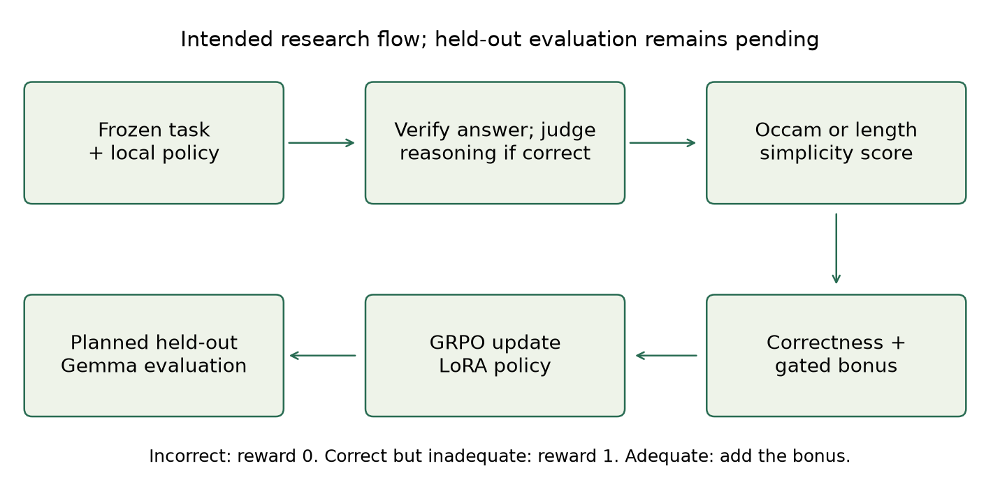
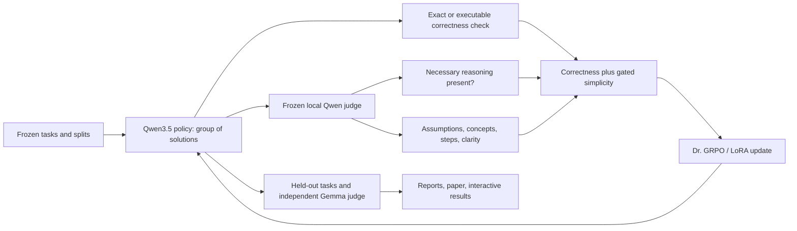

# Occam RL

Can a local language-model judge reward **simpler, fully justified solutions** better than merely rewarding short outputs? This project studies that question with Qwen3.5, group-relative reinforcement learning, deterministic correctness checks, and an independent Gemma 4 evaluator across mathematics, introductory physics, and Python programming.

**Status: data splits are frozen; both initial judge configurations failed qualification. A clearer rating prompt and existing JSON-schema decoder are implemented for the next audit. The user authorized exploratory training despite residual judge noise, after mechanical checks. No policy-training or benchmark results yet.** The hypothesis may fail. Correct final answers can omit essential reasoning; such answers earn correctness credit but **no simplicity bonus**. All model computation runs locally on the available GPU. The first training run is Occam; all standalone baseline inference and baseline training follow it.

The proposed contribution is the controlled comparison of an adequacy-gated semantic simplicity reward against adequacy-gated token and formal-length rewards. Short-reasoning RL already exists: see [ShorterBetter](https://arxiv.org/abs/2504.21370), [StepPruner](https://arxiv.org/abs/2510.03805), and [Dr. GRPO](https://arxiv.org/abs/2503.20783). This project does not claim to invent concise reasoning, compute Kolmogorov complexity, or establish that simpler answers are generally truer.



[Paper PDF](output/pdf/paper.pdf) · [Interactive explorer](https://burnycoder.github.io/occams-razor-reinforcement-learning-llm-as-a-judge/) · [Hugging Face collection](https://huggingface.co/collections/BurnyCoder/occam-rl-adequate-and-parsimonious-reasoning-6afbab26f5969584c8f781e5)



## Research design

[ConciseRL](https://aclanthology.org/2025.findings-emnlp.927/) is close prior art for judged conciseness with correctness gating and reasoning requirements. The study tests the specific rubric, explicit adequacy gate and comparison protocol, without claiming those broad ideas are new.

The training reward is `C * (1 + 0.2 * A * S)`. `C` is binary verified correctness, `A` is judged sufficiency of the complete reasoning, and `S` is the mean of four scores scaled to `[0, 1]`: assumption economy, conceptual economy, reasoning economy, and clarity. All generated thinking and final text count. Required assumptions, units, boundary cases, and useful checking are not penalized merely for taking space. See the [rubric](docs/rubric.md), [preregistration](reports/preregistration.md), and [literature review](reports/literature-review.md).

| Arm | Training or prompting | Status |
|---|---|---|
| Occam | Verified correctness + sufficient-reasoning-gated semantic simplicity | Planned first |
| Accuracy | Verified correctness only | Pending |
| Token length | Same adequacy gate; decreasing token-length reward | Pending |
| Formal length | Same adequacy gate; decreasing math-symbol / code-length reward | Pending |
| Shuffled simplicity | Permute eligible simplicity scores within a prompt group | Pending control |
| Ordinary prompt | Original model; ordinary problem-solving instructions | Pending prompt-only baseline |
| Concise prompt | Original model; request concise but complete solutions | Pending prompt-only baseline |
| Occam prompt | Original model; full semantic rubric and necessary-reasoning requirement | Pending prompt-only baseline |

No measured comparison exists yet. Generated score tables and examples will replace pending entries after evaluation. A shorter answer is not automatically a better answer.

## Models and hardware

Use the published source-build script or checksum-pinned official llama.cpp CUDA binaries for the Gemma judge. The latter avoids requiring a full CUDA compiler installation. Both paths record the upstream source revision.

The policy is [Qwen/Qwen3.5-0.8B](https://huggingface.co/Qwen/Qwen3.5-0.8B), BF16 with LoRA. The initial Qwen3.5-2B NF4 judge failed qualification; [the published amendment](reports/amendment-001-judge-capacity.md) selects [Qwen/Qwen3.5-4B](https://huggingface.co/Qwen/Qwen3.5-4B) NF4 as the next candidate, subject to a fresh audit and GPU-fit checks. The independent evaluator is the newest suitable general-purpose Gemma family, [Gemma 4 E4B Q4_0](https://huggingface.co/google/gemma-4-E4B-it-qat-q4_0-gguf); the preregistered fallback is [Gemma 4 E2B Q4_0](https://huggingface.co/google/gemma-4-E2B-it-qat-q4_0-gguf). Model revisions and the measured evaluator selection will be recorded before evaluation. See [Google's releases](https://ai.google.dev/gemma/docs/releases).

The larger judge also failed its first audit. [Amendment 002](reports/amendment-002-judge-decoding.md) records the rating/decoder correction and the explicit training-only waiver. It preserves every failure and marks affected comparisons exploratory. GPU fit, verifier checks and independent evaluation remain required.

An interrupted revised audit exposed a model/tokenizer end-token mismatch. Generation now honors both declared document and chat terminators using the standard Transformers API; its partial log is retained before rerunning the unchanged audit.

Target machine: RTX 5070 Laptop GPU, approximately 8 GiB VRAM. Model names and weight sizes do not establish fit: the preflight must measure generation, backward, and judge peaks with at least 750 MiB free. Roles run sequentially. Inactive policy weights may be staged in RAM; inference is never silently moved to CPU. Long traces are never truncated to fit the judge. [Unsloth's Qwen3.5 guide](https://unsloth.ai/docs/models/qwen3.5/fine-tune) recommends BF16 LoRA and documents local GRPO with `fast_inference=False`.

## Reproduction and publication order

The verifier also limits host-side output size and forcibly removes timed-out containers. Report generation includes the architecture diagram plus unsmoothed accuracy, reward, length and loss plots when run artifacts exist.

Use Ubuntu through WSL, Python 3.12, `uv`, and the project-local `.venv`. Put model caches and checkpoints on a roomy disk such as `D:\AI\occam-rl` (`/mnt/d/AI/occam-rl` in WSL). Secrets belong in ignored `.env`; start from `.env.example` once implementation is published.

The required order is **write → commit → push → verify remote commit → execute**. This applies to the first test, data preparation, inference, training, report generation, and each rerun after changes. The implementation includes a publication guard. Do not bypass it to run a smoke test. Generated manifests and pinned revisions must themselves be published before training. Dependencies are resolved into `uv.lock` before the first test. See the complete [installation and command reference](docs/usage.md).

```bash
# Ubuntu / WSL, in the published checkout
bash scripts/setup_wsl.sh
uv run --frozen pytest -m 'not sandbox'
uv run --frozen pytest -m sandbox
uv run --frozen occam resolve
# Commit/push generated manifests between phases; see docs/usage.md.
uv run --frozen occam dashboard --port 8765
```

The CLI delegates to separate data, verifier, model, training, evaluation, statistics, reporting, publishing and dashboard modules. `occam report` regenerates measured tables, plots, selected full output examples, experiment reports, the paper PDF and site data. It reports completed judge audits separately from policy scores, preserves failed audits, and tabulates frozen data counts in `reports/readiness.md`. `occam dashboard` serves live rollout accuracy, reward and loss from saved events. [The static explorer](https://burnycoder.github.io/occams-razor-reinforcement-learning-llm-as-a-judge/) is deployed by GitHub Pages.

The initial run uses seed 17. After that model is saved and published, run the three prompt-only baselines, freeze length normalizers from their separate calibration split, then train the accuracy and two length arms. Seeds 29 and 43 and the shuffled control follow. The [plan](reports/plan.md) records the complete sequence, acceptance criteria, and time budget.

## Data and interpretation

Training combines procedural problems with eligible [GSM8K](https://huggingface.co/datasets/openai/gsm8k) and [MBPP](https://huggingface.co/datasets/google-research-datasets/mbpp) training records. Physics includes analytic mechanics and circuits. Evaluation also uses eligible numerical [UGPhysics](https://huggingface.co/datasets/UGPhysics/ugphysics) tasks and [EvalPlus](https://github.com/evalplus/evalplus). Public data retain their own licenses. UGPhysics is noncommercial/share-alike and is evaluation-only. See [data documentation](docs/data.md).

The target confirmatory evaluation has equal domain weights and paired task comparisons, with uncertainty clustered by procedural family. Accuracy must be noninferior within two percentage points, including each domain. Small samples or broad intervals will yield an inconclusive result, not an accuracy-preservation claim. A separate judge audit checks omission detection, dominance pairs, formatting, and prompt injection. These audits are constructed specifications, not substitutes for independent human annotations.

## Roadmap

- [x] Publish research documents and preregistration before any results.
- [x] Publish the complete implementation, tests, lockfile, and README before testing.
- [ ] Verify data, judge behavior, GPU fit, resumability, and logging.
- [ ] Train and publish the first Occam model; then run prompt-only and trained baselines.
- [ ] Generate all result tables, plots, experiment reports, and PDF paper from artifacts.
- [ ] Publish an interactive GitHub Pages explorer and live local accuracy dashboard.
- [ ] Repeat matched experiments across seeds; document negative and positive findings.
- [ ] Evaluate bigger Qwen3.5 models when GPU profiling permits.
- [ ] Measure Lean proof-term structure, dependencies, and axioms programmatically; validate before using as a reward.

Project code is Apache-2.0. See [source and license notes](docs/sources.md). Research author: Libor “Burny” Burian.


## Generated results

<!-- RESULTS:START -->

| Run | Split | N | Accuracy | Adequacy | C × A × S | Tokens | Status |
|---|---|---:|---:|---:|---:|---:|---|
| occam | pending | — | — | — | — | — | not evaluated |
| accuracy | pending | — | — | — | — | — | not evaluated |
| token | pending | — | — | — | — | — | not evaluated |
| formal | pending | — | — | — | — | — | not evaluated |
| shuffled | pending | — | — | — | — | — | not evaluated |
| prompt_ordinary | pending | — | — | — | — | — | not evaluated |
| prompt_concise | pending | — | — | — | — | — | not evaluated |
| prompt_occam | pending | — | — | — | — | — | not evaluated |

<!-- RESULTS:END -->
