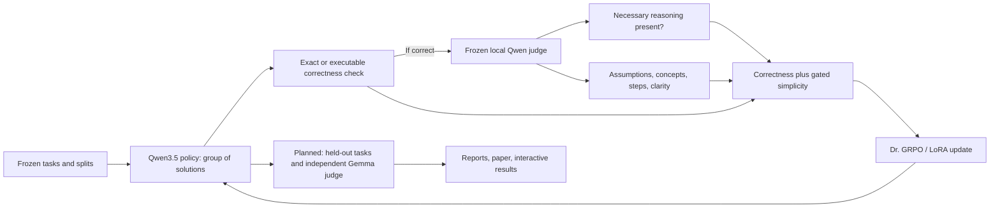
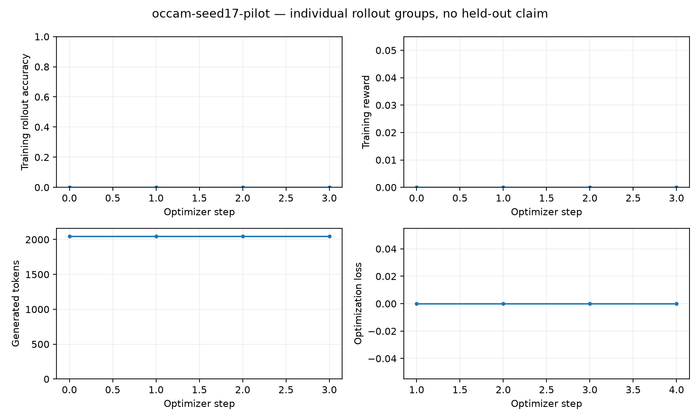

# Occam RL

Can a local language-model judge reward **simpler, fully justified solutions** better than merely rewarding short outputs? This project studies that question with Qwen3.5, group-relative reinforcement learning and deterministic correctness checks across mathematics, introductory physics, and Python programming. Independent Gemma 4 evaluation is planned and has not run.

**Status: the exploratory Occam pilot finished its scheduled updates and saved a checkpoint, without a demonstrated learning signal.** All sampled traces hit the completion cap and failed verification; this does not establish that every mathematical statement in them was wrong. The log records zero reward variation and gradients, and the runtime comparison records no changed trainable tensors. Initial tensors were not separately saved for independent reconstruction. See the [generated diagnostics](#generated-results) and [independent fact-check](reports/independent-fact-check.md). Data splits are frozen. The training judge still fails qualification; the training-only waiver preserves that failure. No retained training or benchmark comparison is complete. Under the [reward rule](docs/rubric.md), correct answers missing essential reasoning earn correctness credit but **no simplicity bonus**. Model execution is configured for the local GPU; retained Occam training must precede standalone baseline inference and baseline training.

The initial startup attempt stopped before rollouts on a Unicode JSONL reader bug; the [documented fix](reports/runtime-integration.md) preserved the frozen data. The completed retry repeatedly reached the output limit without a finished answer. The correctness gate never admitted a trace to the training judge, so this pilot **did not test the semantic reward's effectiveness**. See the [pilot report](reports/experiment-occam-seed17-pilot.md) and [complete raw log](results/runtime/occam-pilot-thinking-events.jsonl).

[Qwen's model card](https://huggingface.co/Qwen/Qwen3.5-0.8B#thinking-mode) documents thinking-loop susceptibility in this small model. This is a candidate explanation, not a tested cause. The next proposed experiment disables thinking mode while retaining explicit necessary reasoning and the other pilot settings. It requires a published amendment and a separate run identity; it has not been implemented or run.

Further model experiments remain paused; this independent audit uses existing artifacts only. The [resume instructions](reports/resume.md) preserve the next proposed experiment and publication order. The [pilot adapter and checkpoint files](https://huggingface.co/BurnyCoder/occam-rl-occam-seed17-pilot) are published as a negative research artifact, with no claim of improved performance.

The proposed contribution is a controlled comparison of an adequacy-gated semantic simplicity reward against matched length and prompting alternatives. ConciseRL already used a correctness-gated semantic conciseness judge. The local trainer adopts Dr. GRPO's constant token denominator and omits within-group standard-deviation scaling, while retaining a nonzero reference-policy KL penalty. [ConciseRL](https://aclanthology.org/2025.findings-emnlp.927/) · [Dr. GRPO, §3 and Appendix G](https://arxiv.org/html/2503.20783v2) · [Local training configuration](src/occam_rl/training.py)


[Paper PDF](output/pdf/paper.pdf) · [Interactive explorer](https://burnycoder.github.io/occams-razor-reinforcement-learning-llm-as-a-judge/) · [Hugging Face collection](https://huggingface.co/collections/BurnyCoder/occam-rl-adequate-and-parsimonious-reasoning-6afbab26f5969584c8f781e5)



## Research design

[ConciseRL](https://aclanthology.org/2025.findings-emnlp.927/) is close prior art for judged conciseness with correctness gating and reasoning requirements. The study tests the specific rubric, explicit adequacy gate and comparison protocol, without claiming those broad ideas are new.

The training reward is `C * (1 + 0.2 * A * S)`. `C` is binary verified correctness, `A` is judged sufficiency of the complete reasoning, and `S` is the mean of four scores scaled to `[0, 1]`: assumption economy, conceptual economy, reasoning economy, and clarity. All generated thinking and final text count. Required assumptions, units, boundary cases, and useful checking are not penalized merely for taking space. See the [rubric](docs/rubric.md), [preregistration](reports/preregistration.md), and [literature review](reports/literature-review.md).

| Arm | Training or prompting | Status |
|---|---|---|
| Occam | Verified correctness + sufficient-reasoning-gated semantic simplicity | Pilot completed without learning; retained run pending |
| Accuracy | Verified correctness only | Pending |
| Token length | Same adequacy gate; decreasing token-length reward | Pending |
| Formal length | Same adequacy gate; decreasing math-symbol / code-length reward | Pending |
| Shuffled simplicity | Permute eligible simplicity scores within a prompt group | Pending control |
| Ordinary prompt | Original model; ordinary problem-solving instructions | Pending prompt-only baseline |
| Concise prompt | Original model; request concise but complete solutions | Pending prompt-only baseline |
| Occam prompt | Original model; full semantic rubric and necessary-reasoning requirement | Pending prompt-only baseline |

No measured comparison exists yet. Generated score tables and examples will replace pending entries after evaluation. A shorter answer is not automatically a better answer.

## Models and hardware

Use the published source-build script or checksum-pinned official llama.cpp CUDA binaries for the Gemma judge. The latter avoids requiring a full CUDA compiler installation. Both paths record the upstream source revision.

The policy is [Qwen/Qwen3.5-0.8B](https://huggingface.co/Qwen/Qwen3.5-0.8B), BF16 with LoRA. The initial Qwen3.5-2B NF4 judge failed qualification. [Amendment 001](reports/amendment-001-judge-capacity.md) selected the current [Qwen/Qwen3.5-4B](https://huggingface.co/Qwen/Qwen3.5-4B) NF4 training judge, whose GPU profile passed but whose revised quality audit also failed.

[Amendment 002](reports/amendment-002-judge-decoding.md) records the rating/decoder corrections, a corrected end-token mismatch, and the explicit training-only waiver. The completed revised audit remains a failure in [its raw artifact](results/judge-audits/qwen-2026-11-17T05-28-33.902+00-00.json) and the [generated audit table](reports/readiness.md). The waiver authorized exploratory training; it does not qualify the judge or waive independent evaluation.

The planned independent evaluator is [Gemma 4 E4B Q4_0](https://huggingface.co/google/gemma-4-E4B-it-qat-q4_0-gguf), with [Gemma 4 E2B Q4_0](https://huggingface.co/google/gemma-4-E2B-it-qat-q4_0-gguf) as the preregistered memory fallback. Model revisions are already [pinned](manifests/revisions.json); measured Gemma selection and qualification remain pending. No held-out Gemma evaluation has run. See [Google's releases](https://ai.google.dev/gemma/docs/releases).

Selecting Unsloth's text-only path allowed the synthetic profile to finish after a processor/tokenizer failure. It checks sampled GPU headroom, trainable tensors and current CUDA RNG across a role switch, and optimizer state-entry counts after reload. It does not establish all-buffer equality, worst-case judge-context fit, or interrupted-training resumption. See the [generated measurements](reports/readiness.md), [profile artifact](manifests/preflight.json) and [profile implementation](src/occam_rl/preflight.py).

Target machine: RTX 5070 Laptop GPU, approximately 8 GiB VRAM. Model names and weight sizes do not establish fit: the preflight must measure generation, backward, and judge peaks with at least 750 MiB free. Roles run sequentially. Inactive policy weights may be staged in RAM; inference is never silently moved to CPU. Long traces are never truncated to fit the judge. [Unsloth's Qwen3.5 guide](https://unsloth.ai/docs/models/qwen3.5/fine-tune) recommends BF16 LoRA and documents local GRPO with `fast_inference=False`.

## Reproduction and publication order

The verifier also limits host-side output size and forcibly removes timed-out containers. Report generation includes the architecture diagram plus unsmoothed accuracy, reward, length and loss plots when run artifacts exist.

Use Ubuntu through WSL, Python 3.12, `uv`, and the project-local `.venv`. Put model caches and checkpoints on a roomy disk such as `D:\AI\occam-rl` (`/mnt/d/AI/occam-rl` in WSL). Secrets belong in ignored `.env`; use `.env.example` for a new installation. The current workspace is already installed; follow the [resume instructions](reports/resume.md) rather than rerunning setup or overwriting frozen manifests.

The required order is **write → commit → push → verify remote commit → execute**. This applies to the first test, data preparation, inference, training, report generation, and each rerun after changes. The implementation includes a publication guard. Do not bypass it to run a smoke test. Generated manifests and pinned revisions must themselves be published before training. Dependencies are resolved into `uv.lock` before the first test. See the complete [installation and command reference](docs/usage.md).

```bash
# Ubuntu / WSL, in the published checkout
bash scripts/setup_wsl.sh
uv run --frozen pytest -m 'not sandbox'
uv run --frozen pytest -m sandbox
uv run --frozen occam resolve
# Commit/push generated manifests between phases; see docs/usage.md.
uv run --frozen occam dashboard --port 8765
```

The CLI delegates to separate data, verifier, model, training, evaluation, statistics, reporting, publishing and dashboard modules. `occam report` regenerates measured tables, plots, selected full output examples, experiment reports, the paper PDF and site data. It reports completed judge audits separately from policy scores, preserves failed audits, and tabulates frozen data counts in `reports/readiness.md`. `occam dashboard` serves live rollout accuracy, reward and loss from saved events. [The static explorer](https://burnycoder.github.io/occams-razor-reinforcement-learning-llm-as-a-judge/) is deployed by GitHub Pages.

The first **retained** Occam run must use seed 17 and be saved and published before standalone baseline inference or training. The completed exploratory pilot does not satisfy that requirement, and its lack of parameter changes prevents selecting a retained training budget. After a successful pilot and the retained Occam run, run the three prompt-only baselines, freeze length normalizers from separate calibration, then train the accuracy and two length arms. Seeds 29 and 43 and the shuffled control follow. The [plan](reports/plan.md) records the complete sequence, acceptance criteria, and time budget.

## Data and interpretation

Training combines procedural problems with eligible [GSM8K](https://huggingface.co/datasets/openai/gsm8k) and [MBPP](https://huggingface.co/datasets/google-research-datasets/mbpp) training records. Physics includes analytic mechanics and circuits. Evaluation also uses eligible numerical [UGPhysics](https://huggingface.co/datasets/UGPhysics/ugphysics) tasks and [EvalPlus](https://github.com/evalplus/evalplus). Public data retain their own licenses. UGPhysics is noncommercial/share-alike and is evaluation-only. See [data documentation](docs/data.md).

The target confirmatory evaluation has equal domain weights and paired task comparisons, with uncertainty clustered by procedural family. Accuracy must be noninferior within two percentage points, including each domain. Small samples or broad intervals will yield an inconclusive result, not an accuracy-preservation claim. A separate judge audit checks omission detection, dominance pairs, formatting, and prompt injection. These audits are constructed specifications, not substitutes for independent human annotations.

## Roadmap

- [x] Retain the original preregistration and implementation history; historical push timing is not independently established by commit dates alone.
- [x] Pass core CPU/container checks and freeze validated data and model revisions.
- [x] Complete training-judge audits, preserve their failures, and document the exploratory waiver.
- [x] Finish the current synthetic GPU profile and its limited state checks.
- [x] Complete and publish the exploratory pilot, including its negative result and full checkpoint.
- [x] Generate current readiness/pilot tables, plots, reports, and PDF paper from artifacts.
- [x] Deploy the interactive GitHub Pages explorer and implement the live local dashboard; the local server is stopped while work is paused.
- [ ] Test the proposed non-thinking pilot with necessary reasoning preserved and a distinct run identity.
- [ ] Demonstrate a useful learning signal, exercise judging inside training, and validate actual interrupted-training resumption.
- [ ] Select and qualify the independent Gemma evaluator before held-out evaluation.
- [ ] Train and publish retained Occam seed 17; then run prompt-only and trained baselines.
- [ ] Repeat matched experiments across seeds; document negative and positive findings.
- [ ] Evaluate bigger Qwen3.5 models when GPU profiling permits.
- [ ] Measure Lean proof-term structure, dependencies, and axioms programmatically; validate before using as a reward.

Project code is Apache-2.0. See [source and license notes](docs/sources.md). Research author: Libor “Burny” Burian.


## Generated results



These are sampled training groups, not held-out scores. Rollout points use the count of updates completed **before sampling**; loss points use completed-update indices. A completed optimizer step does not establish learning. Checkpoint files were saved; real interruption/resumption is still untested. Counts, rejection reasons and figures are regenerated by `occam report` from [raw events](results/runtime/occam-pilot-thinking-events.jsonl).

<!-- RESULTS:START -->

### Training diagnostics

| Run | Updates | Correct / traces | Truncated | Groups with reward spread | Changed tensors | State |
|---|---:|---:|---:|---:|---:|---|
| occam-seed17-pilot | 4 | 0 / 16 | 16 | 0 / 4 | 0 | complete pilot |

occam-seed17-pilot: 16 recorded rollouts across 4 distinct tasks. Repeated rollouts are not independent tasks. Source: https://huggingface.co/datasets/BurnyCoder/occam-rl-artifacts/blob/main/runs/occam-seed17-pilot/events.jsonl

| Verifier rejection reason | Recorded traces |
|---|---:|
| Expected a numeric final answer | 2 |
| Expected exactly one code submission | 4 |
| Expected exactly one final answer | 10 |

### Held-out evaluation

| Run | Split | N | Accuracy | Adequacy | C × A × S | Tokens | Status |
|---|---|---:|---:|---:|---:|---:|---|
| occam | pending | — | — | — | — | — | not evaluated |
| accuracy | pending | — | — | — | — | — | not evaluated |
| token | pending | — | — | — | — | — | not evaluated |
| formal | pending | — | — | — | — | — | not evaluated |
| shuffled | pending | — | — | — | — | — | not evaluated |
| prompt_ordinary | pending | — | — | — | — | — | not evaluated |
| prompt_concise | pending | — | — | — | — | — | not evaluated |
| prompt_occam | pending | — | — | — | — | — | not evaluated |

<!-- RESULTS:END -->
